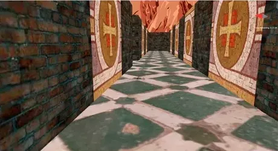
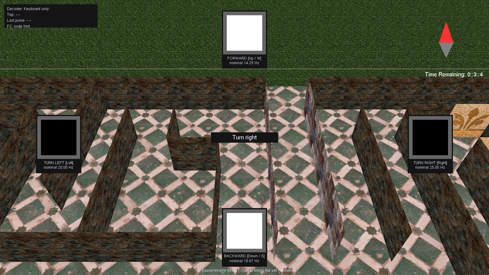

# SSVEP–CCA-Based EEG Navigation

A research project investigating EEG-based control of a 3D maze using steady-state visual evoked potentials (SSVEP) and canonical correlation analysis (CCA). The existing C++/OpenGL/FreeGLUT environment provides a testbed for evaluating neural command decoding and closed-loop navigation.

**Current status:** manual navigation, four frame-sequenced visual targets, map-based route hints, and a live decoder link are implemented. Hardware acquisition and optical measurement tools live in [ssvep-acquisition](https://github.com/neurocontrol-lab/ssvep-acquisition); CCA runs in the companion [ssvep-decoding](https://github.com/neurocontrol-lab/ssvep-decoding) process. Reliable EEG steering still requires validation.

## Research direction

The planned interface associates four flickering visual targets with **forward, backward, turn left, and turn right** commands. CCA will compare windows of multichannel EEG with reference signals at the stimulus frequencies and their harmonics. Confidence thresholds and temporal evidence accumulation will determine when to execute a command.

Planned pipeline:

```text
EEG acquisition → preprocessing → SSVEP/CCA decoding
    → confidence and temporal decision logic → navigation command
```

Initial work will focus on:

- Four fixed screen-space targets, with photodiode validation of their optical frequency and timing.
- Integration of the planned four-channel EEG acquisition system.
- Calibration and evaluation of stimulus frequencies, EEG window lengths, and decision thresholds.
- Evaluation of decoding accuracy, false activations, command latency, maze completion time, and path efficiency.
- Comparison of direct decoding, confidence-gated control, and environment-aware command filtering.

## Branches

- **`main`**: ongoing SSVEP–CCA research and integration, built on the existing navigation environment.
- **`opengl-game`**: preserved OpenGL game baseline before the research reorganization.

## Existing navigation environment

Originally developed for **UCSB CS280, Spring 2022**, the environment includes collision-aware movement, mouse look, strafing and jumping, a compass and timer HUD, and maze layouts loaded from text files.

<p align="center">
  <a href="https://youtu.be/9cJ7eTtbbqo">
    
  </a>
</p>
<p align="center">
  <em>The existing navigation environment used as the testbed for the planned BCI extension. <a href="https://youtu.be/9cJ7eTtbbqo">Watch the environment demo</a>.</em>
</p>

### Manual controls

- **W/S or up/down arrows:** move forward/backward.
- **A/D:** strafe left/right.
- **Left/right arrows:** turn the viewpoint.
- **Mouse:** change viewing direction.
- **Spacebar:** jump.
- **Escape:** exit.

EEG left/right commands also turn the viewpoint.

### Route hint and live decoder run

**Exit hint** uses the loaded walls to find a shortest route in cell steps to an open boundary. It shows **Go forward**, **Turn left**, or **Turn right** at the center of the view. The decoder status and controls stay in the top-left panel. The hint does not depend on EEG and does not move the player. Press **F2** to hide or show it.

Build **Release / x64** in Visual Studio, then launch the executable from the navigation repository root so it can load `resources/`:

```powershell
.\x64\Release\openmaze.exe
```

The maze opens **fullscreen** by default. Add `--windowed` to launch in a resizable window. **Escape** exits either mode.

With `ssvep-decoding` beside this repository, launching the game starts the decoder and enables EEG steering as soon as the focused maze receives a valid, matching stream. Use the **60 Hz** display setting, upload `eeg_streamer`, and close Arduino Serial Monitor/Plotter before launch. The game uses **COM3** and the **4 s / 3 harmonics** profile by default. It uses the decoder's `.venv` or the user's Conda environment named `venv`. Override either setting from PowerShell before launching:

```powershell
$env:SSVEP_DECODER_PORT = 'COM3'
$env:SSVEP_DECODER_PYTHON = 'C:\path\to\python.exe'
```

The launched decoder records under the sibling repository's `sessions/`; startup messages and errors go to `sessions/maze-launch-<game PID>.log`, whose path is printed in the game console. **F3** pauses or resumes steering while recording continues, and retries if the decoder has exited. Closing the game ends the decoder session it launched.

For a keyboard-only run, or to launch the decoder yourself, start the game with `--manual`. To monitor live scores without steering in that mode, run the decoder in another terminal (no PsychoPy window is needed):

```powershell
python -m ssvep_decoding live --port COM3 --seconds 165 --decoder ssvep_decoding/profiles/decoder_4s_3h.json --maze-hud --session sessions/mastoid_maze_monitor_01
```

The HUD shows the top-ranked direction and its score/margin at the top left. The accepted command appears below the centered exit hint. **Last pulse** shows what happened to the last emitted steering command, such as **applied**, **steering paused**, or **no movement (wall)**. Follow the exit hint with your eyes, and move manually when desired. Leave the maze in focus; **F1** pauses/resumes flicker. The game timer is about 185 seconds, so start the decoder soon after launch. A navigation run does not provide synchronized gaze labels for measuring decoding accuracy.

The decoder sends short, versioned UDP messages to `127.0.0.1:46081`. The game [polls without blocking](https://learn.microsoft.com/en-us/windows/win32/winsock/nonblocking-i-o-2). Packets include the four CCA reference frequencies and a [Windows performance-counter timestamp shared across processes](https://docs.python.org/3.10/library/time.html#time.perf_counter). The HUD reports a profile mismatch if any reference differs by more than **0.10 Hz** from the game's nominal frequency. This catches configuration mismatches; it does not measure optical timing.

For EEG steering, replace `--maze-hud` with `--maze-control` and use a new session name. Steering activates automatically the first time the focused game has synchronized flicker and a matching, valid control stream. Only newly emitted decisions produce a brief movement pulse, using the existing movement and collision code. Manual movement overrides the pulse. **F3** pauses or resumes steering. Focus loss, stale or rejected data, a frequency mismatch, paused flicker, or the end of a game disarms steering; press **F3** after the stream is ready again to resume. With the current research gates, a run can show scores without emitting any commands.

### Visual targets

For optical frequency checks, use the [BPW34 + XIAO MG24 validation sketch and setup guide](https://github.com/neurocontrol-lab/ssvep-acquisition/blob/main/firmware/photodiode_validation/README.md). It reads the photodiode on **D10**, records a buffered capture, reports frequency and timing statistics, and exports raw CSV data.

<p align="center">
  
</p>
<p align="center">
  <em>Four directional SSVEP targets overlaid on the maze. This screenshot captures their appearance at one instant; it does not show or validate flicker timing.</em>
</p>

Four opaque black/white squares are anchored at top center (forward), bottom center (backward), left center (turn left), and right center (turn right). Their centers are inset to 12%/88% of the viewport; their size scales from 140 pixels at 1920 x 1080. Static labels sit outside the flickering area, and the upper-right compass/timer remains in place.

- **F1:** pause/resume flicker. Paused targets remain visible in gray; resuming restarts their frame sequence.
- Flicker pauses during victory/game-over screens.
- VSync is requested at startup. If unavailable, targets start paused; F1 can enable an unvalidated preview.

Provisional sequences (one sequence step per buffer swap). Assuming one swap per display refresh, **nominal stimulus frequency = monitor refresh rate / total frames per cycle**. Values below are in Hz, rounded to two decimal places; they are calculated fundamentals, not measured optical output.

| Target | Bright/dark frames | 60 Hz monitor | 75 Hz monitor | 90 Hz monitor | 100 Hz monitor | 120 Hz monitor |
|---|---|---|---|---|---|---|
| Forward | 3 / 4 | 8.57 | 10.71 | 12.86 | 14.29 | 17.14 |
| Backward | 3 / 3 | 10.00 | 12.50 | 15.00 | 16.67 | 20.00 |
| Turn left | 2 / 3 | 12.00 | 15.00 | 18.00 | 20.00 | 24.00 |
| Turn right | 2 / 2 | 15.00 | 18.75 | 22.50 | 25.00 | 30.00 |

**Relation to gamma:** gamma is commonly described as approximately 30–80 Hz, with boundaries varying across studies ([human visual cortex study](https://pubmed.ncbi.nlm.nih.gov/24855114/)). These fundamentals span 8.57–30 Hz across the listed refresh rates: most are below gamma, and the right target at 120 Hz reaches its commonly used lower boundary. They are therefore not all "within gamma," nor strictly below 30 Hz. Gamma-band boundaries are not a stimulation safety or comfort limit. Harmonics used by CCA can extend into and above gamma; for example, a 30 Hz fundamental has second and third harmonics at 60 and 90 Hz. Select acquisition/filter bandwidth and CCA references for the harmonics actually used.

The named `SSVEP_*` settings and target table in `Constants.cpp` define frame periods, positions, reference resolution, target size, and spacing. Target dimensions are derived from the viewport at runtime; bitmap-label spacing stays in pixels. Odd periods have unequal bright/dark durations. Frequencies scale with display refresh rate; labels use the OS-reported rate, not an optical measurement. Driver overrides, variable refresh, missed refreshes, and compositor behavior can change actual timing. Use fixed refresh and validate every target with a photodiode while navigating before EEG experiments. These provisional frequencies are not a calibrated CCA configuration; assess harmonic overlap and decoding performance before selecting the final set.

The initial stimulus is solid monochrome to simplify timing measurements. Colored or patterned stimuli require separate contrast and decoding validation; the stimulus does not inherit maze lighting or textures.

## Companion acquisition repository

[ssvep-acquisition](https://github.com/neurocontrol-lab/ssvep-acquisition) contains the MG24 firmware, BPW34 optical measurement tools, BioAmp diagnostics, Python CSV capture script, and their tests. Clone it alongside this repository; it is not required to build or run the navigation UI.

Optical validation of all four targets under navigation load remains pending. See the acquisition repository for wiring, capture instructions, and measurement limitations.

## Background and demo

- **Portable Windows x86 baseline:** [Play_Game.zip](../../raw/refs/heads/opengl-game/resources/Play_Game.zip) (launch using `Play_Game.bat`).
- **Environment demo:** [Video](https://www.youtube.com/watch?v=9cJ7eTtbbqo).
- **Original course assignment explanation:** [Video](https://www.youtube.com/watch?v=O8dUZq9Oty0).
- **Original course assignment:** [HW1.pdf](resources/HW1.pdf).
