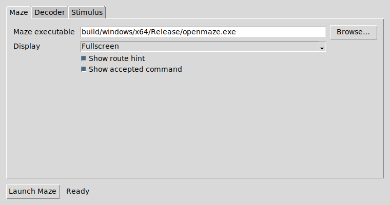
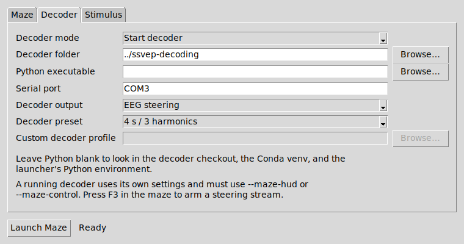
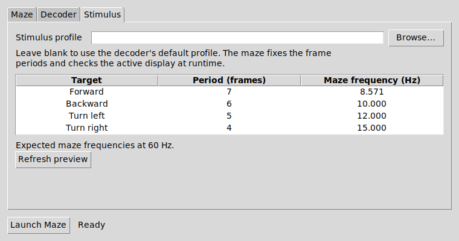

# SSVEP Navigation UI

This Windows research testbed uses four flickering targets to investigate EEG control of a 3D maze. The targets correspond to forward, backward, turn left, and turn right. The maze supports manual navigation, route hints, live decoder monitoring, and experimental EEG steering.

## Run the maze on Windows

Open `build/windows/openmaze.sln` in Visual Studio and build **Release / x64**. The launcher uses Python 3.10 or newer with Tk. [Build and setup guide](docs/command-line.md#build-the-maze)

Open `run-navigation.cmd` on Windows or run it from PowerShell in the repository root.

```powershell
.\run-navigation.cmd
```

1. In **Maze**, choose fullscreen or windowed mode. Set the route hint and accepted-command overlay independently. The executable defaults to the Release x64 build.
2. In **Decoder**, choose **Keyboard only** to explore the maze, **Start decoder** to launch a decoder from a checkout, or **Use running decoder** to connect to an existing local stream. For **Start decoder**, select the checkout, Python executable, serial port, output mode, and a preset or custom decoder JSON. The default preset is **4 s / 3 harmonics**. **Monitor only** shows decisions in the HUD while you drive with the keyboard.
3. In **Stimulus**, preview the maze's frame periods and expected frequencies. Use the default profile with a 60 Hz display or select a stimulus JSON that matches your display. The maze checks the decoder's reference frequencies against the active display before enabling steering. [Stimulus timing and frequency table](docs/stimulus.md)
4. For live EEG, upload the MG24 EEG streamer, close Arduino Serial Monitor or Plotter, and check the serial port. Click **Launch Maze**. For an attached steering stream, press **F3** in the focused maze once valid EEG arrives.



<details>
<summary>Decoder and Stimulus tabs</summary>





</details>

## macOS and Linux

The maze and navigation launcher require Windows. Use the companion decoder's standalone PsychoPy launcher for cued EEG tests on macOS or Linux. [Decoder launch instructions](https://github.com/neurocontrol-lab/ssvep-decoding#run-a-test)

## In the maze

| Control | Action |
|---|---|
| W/S or Up/Down | Move forward or backward |
| A/D | Strafe left or right |
| Left/Right or mouse | Turn or look around |
| Space | Jump |
| F1 | Pause or resume flicker |
| F2 | Show or hide the route hint |
| F3 | Pause or resume EEG steering when a steering stream is available |
| Escape | Exit the maze |

The top-left HUD shows decoder status, the top-ranked direction, its score and margin, and the outcome of the last steering pulse. When both overlays are enabled, the accepted command appears below the route hint. Closing the maze stops a decoder it started. Its recording and live summary are saved in the decoder checkout. [Navigation behavior and recording details](docs/navigation.md)

## Visual targets


The screenshot shows the four targets at one instant during a keyboard-only run.

## Documentation

| Guide | Contents |
|---|---|
| [Command line](docs/command-line.md) | Build, launcher interpreter settings, direct executable options, and standalone decoder commands |
| [Navigation](docs/navigation.md) | Route hints, EEG steering, recording locations, and project background |
| [Stimulus](docs/stimulus.md) | Target layout, frame sequences, frequencies from 60 to 120 Hz, and optical validation |

## Related repositories

- **ssvep-acquisition** provides the MG24 firmware for four-channel EEG streaming and the BPW34 tools for measuring the maze's flicker. [Acquisition firmware and tools](https://github.com/neurocontrol-lab/ssvep-acquisition)
- **ssvep-decoding** runs CCA on the EEG stream and sends scores and accepted commands to the maze over local UDP. It also provides a standalone PsychoPy test launcher for cued EEG experiments. [Decoder and test launcher](https://github.com/neurocontrol-lab/ssvep-decoding)
