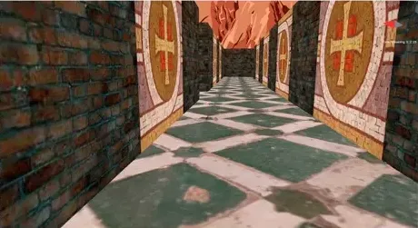

# Navigation and EEG steering

The exit hint uses the loaded walls to find a shortest route, in cell steps, to an open boundary. It shows **Go forward**, **Turn left**, or **Turn right** at the center of the view. The maze calculates the hint from your position and heading. Press **F2** to show or hide it. The accepted-command overlay shows the currently accepted direction when available. EEG left and right commands turn the viewpoint.

## Live decoder link

The decoder sends decisions to `127.0.0.1:46081` over UDP. Each message carries the decoder state, scores, accepted action, four reference frequencies, and a Windows performance-counter timestamp. The maze reports **Frequency profile mismatch** when a reference differs from its nominal stimulus frequency by more than **0.10 Hz**. Use the photodiode workflow to measure optical timing. [Stimulus guide](stimulus.md)

With **Start decoder** and **EEG steering**, steering arms when the focused maze has synchronized flicker and receives a valid, matching control stream. With **Use running decoder**, press **F3** to arm a compatible steering stream. **Monitor only** displays decoder decisions while you drive manually.

Only a new emitted decision can trigger a short movement pulse. The maze applies its usual movement and collision rules, and manual movement overrides the pulse. **Last pulse** shows outcomes such as **applied**, **steering paused**, or **no movement (wall)**. A high-scoring target may yield no pulse when it fails the decoder's score, margin, or persistence requirements.

Focus loss, stale or rejected data, a frequency mismatch, paused flicker, or the end of the game disarms steering. Press **F3** after the stream is ready to resume. When the maze started the decoder and it has exited, F3 can retry the launch. The maze timer lasts about 185 seconds, so start an attached decoder promptly. [Direct launch and attach commands](command-line.md)

## Recordings

For a decoder started by the maze, look in the selected decoder checkout.

| Path | Contents |
|---|---|
| `sessions/maze-launch-<game-pid>.log` | Decoder startup messages and errors. The maze console prints this path. |
| `sessions/<session-id>/` | Raw EEG, per-window decisions, and resolved decoder and stimulus settings. |
| `results/<session-id>/live/` | The decoder's live summary. |

The maze requests shutdown when it closes a decoder it started. Stop an attached decoder in its own terminal. Maze runs lack synchronized gaze cues for measuring decoding accuracy. Use the decoder's standalone tests for cued and rest recordings. [Decoder test launcher and session catalog](https://github.com/neurocontrol-lab/ssvep-decoding)

## Research and project background

The project uses canonical correlation analysis (CCA) to compare four-channel EEG against the target frequencies and their harmonics. Research goals include calibrating the timing and decoder settings, measuring false activations and command latency, evaluating maze completion time and path efficiency, and comparing direct control with confidence gates or route-aware filtering. Reliable EEG steering remains a research goal.

The maze originated in UCSB CS280 in spring 2022. It includes collision-aware movement, mouse look, strafing, jumping, a compass and timer HUD, and text-based maze layouts. The `main` branch contains the EEG integration. The `opengl-game` branch preserves the original game.

- [Portable Windows x86 baseline](https://github.com/neurocontrol-lab/ssvep-navigation-ui/raw/refs/heads/opengl-game/resources/Play_Game.zip) runs with `Play_Game.bat`.
- [Environment demo](https://www.youtube.com/watch?v=9cJ7eTtbbqo)
- [Original course assignment](../resources/HW1.pdf) and [video walkthrough](https://www.youtube.com/watch?v=O8dUZq9Oty0)
